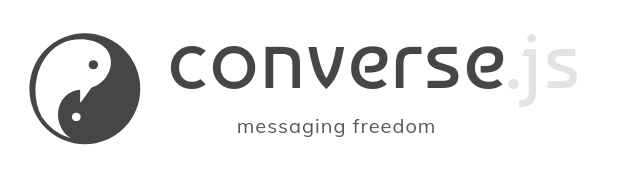

<h2 align="center">

  <a href="https://conversejs.org" target="_blank" rel="noopener">
    
  </a>
</h2>

[](https://chat.conversejs.org/#discuss@conference.conversejs.org?join)
[](https://github.com/conversejs/converse.js/actions/workflows/tests.yml)
[](https://hosted.weblate.org/engage/conversejs/?utm_source=widget)

[Converse](https://conversejs.org) is a modern, feature-rich [XMPP](https://xmpp.org) chat client.
It runs in the browser, as a standalone web app or integrated into existing websites,
and its headless core ([`@converse/headless`](https://www.npmjs.com/package/@converse/headless)) also runs in Node.js.

Join our [chat room](https://chat.conversejs.org/#discuss@conference.conversejs.org?join) (XMPP URL: [discuss@conference.conversejs.org](xmpp:discuss@conference.conversejs.org?join)).


## Quick Start

Try the hosted app at [conversejs.org](https://conversejs.org/fullscreen.html).
You can also download and install [Converse Desktop](https://github.com/conversejs/converse-desktop/releases) or [Converse Tauri](https://github.com/conversejs/converse-tauri/releases).

Or set up your own instance:

```bash
git clone --filter=blob:none https://github.com/conversejs/converse.js.git
cd converse.js
git clone https://github.com/conversejs/media.git media  # images such as sponsor logos
npm install
npm run build
npm run serve -- -p 8008
```

You can then open http://localhost:8008/dev.html in your browser to access Converse.

The repository has a long history, so `--filter=blob:none` makes a blobless clone,
which downloads the contents of older file versions only when they're needed.
Use `--depth 1` instead if you don't need the history at all.

See our [quickstart guide](https://conversejs.org/docs/quickstart/) for more details.

## Screenshots

Converse can be displayed in three ways. Click a screenshot to see it full size.

<table>
  <tr>
    <td align="center" width="33%">
      <a href="https://conversejs.org/media/screenshots/converse-enter-muc.png"></a><br>
      <strong>Fullpage</strong> (default)<br>
      A single-page application covering the entire viewport.
    </td>
    <td align="center" width="33%">
      <a href="https://conversejs.org/media/screenshots/converse-overlayed.png"></a><br>
      <strong>Overlay</strong><br>
      Chat boxes appear on top of your website.
    </td>
    <td align="center" width="33%">
      <a href="https://conversejs.org/media/screenshots/converse-prosody.png"></a><br>
      <strong>Embedded</strong><br>
      Converse integrates into specific elements in your page's DOM.
    </td>
  </tr>
</table>

## Live Demos

- **[Main App](https://conversejs.org/fullscreen.html)**: Try the full application
- **[Anonymous Login](https://conversejs.org/demo/anonymous.html)**: Test without creating an account
- **[Embedded Chat Room](https://conversejs.org/demo/embedded.html)**: See how to embed a single chat room

## Documentation

Comprehensive documentation is available at [conversejs.org/docs](https://conversejs.org/docs/), including:

- [Quickstart Guide](https://conversejs.org/docs/quickstart/)
- [Configuration Options](https://conversejs.org/docs/configuration/)
- [Plugin Development](https://conversejs.org/docs/development/plugin-development/)

## Key Features

- **Multiple UI Options**: Overlay chat boxes, full-page application, or embedded components
- **Rich Messaging**: Message styling, corrections, reactions, and URL previews
- **Privacy-Focused**: End-to-end encryption with OMEMO
- **Audio Calls**: 1:1 audio calls over Jingle (since 15.0.0)
- **Voice Messages**: Record and send voice messages, via an opt-in plugin (since 15.0.0)
- **Microblogging**: Follow and post to social feeds (since 15.0.0)
- **User Status**: Custom status messages and availability indicators
- **Notifications**: Desktop notifications for new messages
- **File Sharing**: HTTP File Upload support
- **Extensible**: Plugin architecture based on [pluggable.js](https://conversejs.github.io/pluggable.js/)
- **Internationalized**: Translated into 40+ languages
- **Anonymous Login**: Use without registration (server permitting)
- **Responsive**: Works on desktop and mobile devices

## XMPP Protocol Support

Converse implements a wide range of XMPP Extensions (XEPs), making it one of the most protocol-compliant web clients available.

<details>
<!-- xeps:start -->
<summary><strong>View all 74 supported XEPs and 5 RFCs</strong></summary>

| Spec | Name | Status | Since | Notes |
| --- | --- | --- | --- | --- |
| [RFC 6120](https://www.rfc-editor.org/info/rfc6120) | XMPP: Core |  |  |  |
| [RFC 6121](https://www.rfc-editor.org/info/rfc6121) | XMPP: Instant Messaging and Presence |  |  |  |
| [RFC 6122](https://www.rfc-editor.org/info/rfc6122) | XMPP: Address Format |  |  |  |
| [RFC 7395](https://www.rfc-editor.org/info/rfc7395) | XMPP Subprotocol for WebSocket |  |  |  |
| [RFC 7590](https://www.rfc-editor.org/info/rfc7590) | Use of Transport Layer Security (TLS) in XMPP |  |  |  |
| [XEP-0004](https://xmpp.org/extensions/xep-0004.html) | Data Forms | Complete |  |  |
| [XEP-0030](https://xmpp.org/extensions/xep-0030.html) | Service Discovery | Complete | 0.8.2 |  |
| [XEP-0045](https://xmpp.org/extensions/xep-0045.html) | Multi-User Chat | Complete |  |  |
| [XEP-0048](https://xmpp.org/extensions/xep-0048.html) | Bookmarks | Complete | 2.0.1 |  |
| [XEP-0050](https://xmpp.org/extensions/xep-0050.html) | Ad-Hoc Commands | Complete | 7.0.0 |  |
| [XEP-0054](https://xmpp.org/extensions/xep-0054.html) | vcard-temp | Complete |  |  |
| [XEP-0059](https://xmpp.org/extensions/xep-0059.html) | Result Set Management | Complete |  |  |
| [XEP-0060](https://xmpp.org/extensions/xep-0060.html) | Publish-Subscribe | Complete |  |  |
| [XEP-0066](https://xmpp.org/extensions/xep-0066.html) | Out of Band Data | Complete | 4.0.0 |  |
| [XEP-0077](https://xmpp.org/extensions/xep-0077.html) | In-Band Registration | Complete | 0.8.5 |  |
| [XEP-0085](https://xmpp.org/extensions/xep-0085.html) | Chat State Notifications | Complete |  |  |
| [XEP-0092](https://xmpp.org/extensions/xep-0092.html) | Software Version | Complete |  |  |
| [XEP-0115](https://xmpp.org/extensions/xep-0115.html) | Entity Capabilities | Complete |  |  |
| [XEP-0122](https://xmpp.org/extensions/xep-0122.html) | Data Forms Validation | Partial |  | basic string field sub-type usage |
| [XEP-0124](https://xmpp.org/extensions/xep-0124.html) | Bidirectional-streams Over Synchronous HTTP (BOSH) | Complete |  |  |
| [XEP-0144](https://xmpp.org/extensions/xep-0144.html) | Roster Item Exchange | Complete |  |  |
| [XEP-0147](https://xmpp.org/extensions/xep-0147.html) | XMPP URI Scheme Query Components | Partial |  | Clicking an xmpp: URI dispatches the feasible query actions: message, join, roster (add a contact), subscribe/unsubscribe and remove. vCard, ad-hoc command, disco, register and file-transfer query types are not handled. Converse can also be registered as the browser's handler for the xmpp: URI scheme, so that links clicked outside Converse are dispatched the same way. |
| [XEP-0153](https://xmpp.org/extensions/xep-0153.html) | vCard-Based Avatars | Complete | 11.0.0 |  |
| [XEP-0156](https://xmpp.org/extensions/xep-0156.html) | Discovering Alternative XMPP Connection Methods | Complete | 6.0.0 |  |
| [XEP-0163](https://xmpp.org/extensions/xep-0163.html) | Personal Eventing Protocol | Complete |  |  |
| [XEP-0166](https://xmpp.org/extensions/xep-0166.html) | Jingle | Partial |  | Used for one-to-one audio calls. Adding, modifying or removing contents, and replacing transports, are refused. |
| [XEP-0167](https://xmpp.org/extensions/xep-0167.html) | Jingle RTP Sessions | Partial |  | Audio only, no video. Informational session-info payloads (ringing, mute, hold) are acknowledged but neither acted upon nor sent. |
| [XEP-0172](https://xmpp.org/extensions/xep-0172.html) | User Nickname | Complete |  |  |
| [XEP-0176](https://xmpp.org/extensions/xep-0176.html) | Jingle ICE-UDP Transport Method | Complete |  | UDP candidates only, trickled, with ICE restarts. |
| [XEP-0184](https://xmpp.org/extensions/xep-0184.html) | Message Delivery Receipts | Complete |  |  |
| [XEP-0191](https://xmpp.org/extensions/xep-0191.html) | Blocking Command | Complete | 11.0.0 |  |
| [XEP-0198](https://xmpp.org/extensions/xep-0198.html) | Stream Management | Complete | 5.0.0 |  |
| [XEP-0199](https://xmpp.org/extensions/xep-0199.html) | XMPP Ping | Complete |  |  |
| [XEP-0202](https://xmpp.org/extensions/xep-0202.html) | Entity Time | Partial |  | 1:1 chats only, no MUC occupant support |
| [XEP-0203](https://xmpp.org/extensions/xep-0203.html) | Delayed Delivery | Complete |  |  |
| [XEP-0206](https://xmpp.org/extensions/xep-0206.html) | XMPP Over BOSH | Complete |  |  |
| [XEP-0215](https://xmpp.org/extensions/xep-0215.html) | External Service Discovery | Partial |  | STUN and TURN servers are discovered for calls, and credentials are requested for restricted ones. Pushed service updates are not handled. |
| [XEP-0223](https://xmpp.org/extensions/xep-0223.html) | Persistent Storage of Private Data via PubSub | Complete |  |  |
| [XEP-0245](https://xmpp.org/extensions/xep-0245.html) | The /me Command | Complete |  |  |
| [XEP-0249](https://xmpp.org/extensions/xep-0249.html) | Direct MUC Invitations | Complete | 0.8.2 |  |
| [XEP-0277](https://xmpp.org/extensions/xep-0277.html) | Microblogging over XMPP | Partial |  | Authoring geolocation is not implemented. |
| [XEP-0280](https://xmpp.org/extensions/xep-0280.html) | Message Carbons | Complete | 0.8.0 |  |
| [XEP-0293](https://xmpp.org/extensions/xep-0293.html) | Jingle RTP Feedback Negotiation | Complete |  |  |
| [XEP-0294](https://xmpp.org/extensions/xep-0294.html) | Jingle RTP Header Extensions Negotiation | Complete |  |  |
| [XEP-0297](https://xmpp.org/extensions/xep-0297.html) | Stanza Forwarding | Complete |  |  |
| [XEP-0308](https://xmpp.org/extensions/xep-0308.html) | Last Message Correction | Complete | 4.0.0 |  |
| [XEP-0313](https://xmpp.org/extensions/xep-0313.html) | Message Archive Management | Complete | 0.9.5 |  |
| [XEP-0317](https://xmpp.org/extensions/xep-0317.html) | Hats | Complete |  |  |
| [XEP-0319](https://xmpp.org/extensions/xep-0319.html) | Last User Interaction in Presence | Complete | 4.0.5 |  |
| [XEP-0320](https://xmpp.org/extensions/xep-0320.html) | Use of DTLS-SRTP in Jingle Sessions | Complete |  |  |
| [XEP-0330](https://xmpp.org/extensions/xep-0330.html) | Pubsub Subscription | Partial |  | The follow-list backing the "Social" app: publishing and retracting entries on the user's own subscription node as they follow and unfollow, reading a contact's list of followed feeds, and live multi-device synchronisation of the user's own list (a follow or unfollow on one device propagates to the others via a +notify subscription). The followers side is not exposed. |
| [XEP-0333](https://xmpp.org/extensions/xep-0333.html) | Displayed Markers | Partial | 4.1.1 |  |
| [XEP-0338](https://xmpp.org/extensions/xep-0338.html) | Jingle Grouping Framework | Complete |  |  |
| [XEP-0339](https://xmpp.org/extensions/xep-0339.html) | Source-Specific Media Attributes in Jingle | Complete |  |  |
| [XEP-0352](https://xmpp.org/extensions/xep-0352.html) | Client State Indication | Complete | 0.9.4 |  |
| [XEP-0353](https://xmpp.org/extensions/xep-0353.html) | Jingle Message Initiation | Partial |  | We do not propose again to resume a call of our own after a reconnection or reload, so only the peer can migrate a call. |
| [XEP-0357](https://xmpp.org/extensions/xep-0357.html) | Push Notifications | Complete | 4.0.0 |  |
| [XEP-0359](https://xmpp.org/extensions/xep-0359.html) | Unique and Stable Stanza IDs | Complete |  |  |
| [XEP-0363](https://xmpp.org/extensions/xep-0363.html) | HTTP File Upload | Complete | 4.0.0 |  |
| [XEP-0371](https://xmpp.org/extensions/xep-0371.html) | Jingle ICE Transport Method | Complete |  |  |
| [XEP-0372](https://xmpp.org/extensions/xep-0372.html) | References | Complete |  |  |
| [XEP-0382](https://xmpp.org/extensions/xep-0382.html) | Spoiler messages | Complete | 3.3.3 |  |
| [XEP-0384](https://xmpp.org/extensions/xep-0384.html) | OMEMO Encryption | Complete | 4.0.0 |  |
| [XEP-0392](https://xmpp.org/extensions/xep-0392.html) | Consistent Color Generation | Complete | 11.0.0 |  |
| [XEP-0393](https://xmpp.org/extensions/xep-0393.html) | Message Styling | Complete | 8.0.0 |  |
| [XEP-0402](https://xmpp.org/extensions/xep-0402.html) | PEP Native Bookmarks | Complete | 11.0.0 |  |
| [XEP-0410](https://xmpp.org/extensions/xep-0410.html) | MUC Self-Ping (Schrödinger's Chat) | Complete | 5.0.0 |  |
| [XEP-0420](https://xmpp.org/extensions/xep-0420.html) | Stanza Content Encryption | Complete | 14.0.0 |  |
| [XEP-0421](https://xmpp.org/extensions/xep-0421.html) | Occupant identifiers for semi-anonymous MUCs | Complete |  |  |
| [XEP-0422](https://xmpp.org/extensions/xep-0422.html) | Message Fastening | Complete |  |  |
| [XEP-0424](https://xmpp.org/extensions/xep-0424.html) | Message Retraction | Complete | 6.0.0 |  |
| [XEP-0425](https://xmpp.org/extensions/xep-0425.html) | Moderated Message Retraction | Complete | 6.0.0 |  |
| [XEP-0431](https://xmpp.org/extensions/xep-0431.html) | Full Text Search in MAM | Complete |  |  |
| [XEP-0437](https://xmpp.org/extensions/xep-0437.html) | Room Activity Indicators | Complete | 8.0.0 |  |
| [XEP-0444](https://xmpp.org/extensions/xep-0444.html) | Message Reactions | Complete | 13.0.0 |  |
| [XEP-0454](https://xmpp.org/extensions/xep-0454.html) | OMEMO Media sharing | Complete | 8.0.0 |  |
| [XEP-0461](https://xmpp.org/extensions/xep-0461.html) | Message Replies | Complete |  |  |
| [XEP-0469](https://xmpp.org/extensions/xep-0469.html) | Bookmark Pinning | Complete | 15.0.0 | Pinned groupchats are shown at the top of the list of open groupchats. Pinned bookmarks of groupchats that aren't open aren't shown. |
| [XEP-0472](https://xmpp.org/extensions/xep-0472.html) | Pubsub Social Feed | Partial |  | Microblog profile of the Pubsub Social Feed: the social-feed discovery feature and Base-profile node config used by the "Social" app. Gallery-profile nodes are rendered (consume-only, as an image grid); creating/hosting gallery nodes is not implemented. |
<!-- xeps:end -->

</details>

## Integration Options

Converse integrates with popular platforms and frameworks:

### XMPP Servers

| Server                                                        | Plugin                                                                                 |
| ------------------------------------------------------------- | -------------------------------------------------------------------------------------- |
| [Openfire](https://www.igniterealtime.org/projects/openfire/) | [inverse](https://www.igniterealtime.org/projects/openfire/plugins.jsp)                |
| [Prosody](https://prosody.im/)                                | [mod_conversejs](https://modules.prosody.im/mod_conversejs.html)                       |
| [ejabberd](https://ejabberd.im/)                              | [mod_conversejs](https://docs.ejabberd.im/admin/configuration/modules/#mod_conversejs) |

### Web Frameworks & CMS

| Platform                                                                | Integration                                                                                          |
| ----------------------------------------------------------------------- | ---------------------------------------------------------------------------------------------------- |
| [Elgg](https://elgg.org)                                                | [plugin](https://elgg.org/plugins/2997196)                                                           |
| [Peertube](https://github.com/JohnXLivingston/peertube-plugin-livechat) | [peertube-plugin-livechat](https://github.com/JohnXLivingston/peertube-plugin-livechat)              |
| [Pàdé](https://www.igniterealtime.org/projects/pade/index.jsp)          | [Pàdé](https://www.igniterealtime.org/projects/pade/index.jsp)                                       |
| [Roundcube](https://roundcube.net)                                      | [roundcube-converse.js-xmpp-plugin](https://github.com/devurandom/roundcube-converse.js-xmpp-plugin) |
| [Tiki Wiki CMS Groupware](https://tiki.org)                             | [built-in optional feature](https://doc.tiki.org/XMPP)                                               |
| [Ubuntu-Touch](https://open-store.io/app/conversejs.luigi311)           | [ConverseJS for Ubuntu-Touch](https://open-store.io/app/conversejs.luigi311)                         |
| [WordPress](https://wordpress.org)                                      | [ConverseJS Plugin](https://wordpress.org/plugins/conversejs/)                                       |

## LLM and GenAI usage

Large Language Models have been and may be used to assist with Converse's development,
including writing and refactoring code, editing documentation and research.

Converse does not implement its own cryptography. OMEMO end-to-end encryption is
delegated to [libomemo.js](https://github.com/conversejs/libomemo.js); see that
project's own [LLM and GenAI usage](https://github.com/conversejs/libomemo.js#llm-and-genai-usage)
note for how its security-critical code is verified.

Within Converse, correctness is checked independently of any AI. The test suite
runs in a real browser, and every change, however it was drafted, is reviewed by
a human maintainer who remains responsible for it, exactly as for any third-party
contribution.

### Contributing with AI assistance

Using LLMs or coding agents to help write your contribution is allowed. AI is a
legitimate tool, and we won't reject a patch simply because a model helped write
it, but the bar is the same as for any other pull request:

- **Understand what you submit.** You are responsible for your contribution. Be
  able to explain how it works and why it's correct.
- **Test it.** Your code must build and pass the test suite, and new behaviour
  should come with tests.
- **Disclose it.** Note in your pull request that AI tooling was used. This is
  about honesty and giving reviewers context, not stigma.
- **No slop.** Unreviewed, untested, auto-generated output thrown over the fence
  will be closed.

If you're driving Converse with a coding agent, start with
[`AGENTS.md`](./AGENTS.md), which documents the architecture, conventions and
build/test workflow the project expects.

The repo also comes with a code review skill,
[`codereview-conversejs`](./.agents/skills/codereview-conversejs/SKILL.md).
It checks a change against the project's architectural rules as well as the usual
correctness and testing concerns. It uses the open [Agent Skills](https://agentskills.io)
format, so coding agents that support skills (such as Codex, Claude Code and
OpenCode) can pick it up automatically when you work in this repo. To run it
explicitly, use `$codereview-conversejs` in Codex or `/codereview-conversejs` in
Claude Code, or ask your agent to use the skill by name. Running it on your change
before you open a pull request is a good way to catch problems early, but it
doesn't replace your own review or the maintainers'.

## Support the Project

If you find Converse useful, please consider supporting its development:

- [GitHub Sponsors](https://github.com/sponsors/jcbrand)
- [Patreon](https://www.patreon.com/jcbrand)
- [Liberapay](https://liberapay.com/jcbrand)

Thanks to everyone who has supported this project over the years through donations, testing, bug reports, and code contributions.

## Sponsors

<p align="center">
  <a href="https://blokt.com?utm_source=conversejs" target="_blank" rel="noopener">
    
  </a>
  <a href="https://www.litslink.com?utm_source=conversejs" target="_blank" rel="noopener">
    
  </a>
  <a href="https://www.keycdn.com?utm_source=conversejs" target="_blank" rel="noopener">
    
  </a>
</p>
